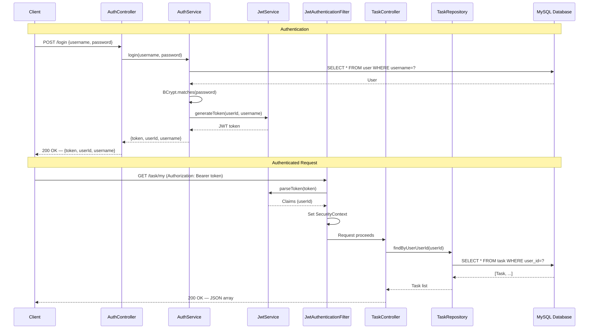

# Task Manager

A Spring Boot REST API for personal task lists, with JWT authentication, MySQL storage and a small built-in web interface.

[](https://github.com/FranciscoGoal/Task-Manager/actions/workflows/maven.yml)


## Purpose

This was my first Spring Boot project. It began as an in-memory CRUD API backed by H2 and grew step by step: MySQL persistence, password hashing, JWT login and registration, a browser interface, a Dockerfile and a CI pipeline. The commit history shows each step.

## Features

- **Task CRUD** over REST, plus `GET /task/my`, which returns only the authenticated user's tasks.
- **Registration and login** that return a JWT signed with HMAC-SHA via jjwt 0.12. The token's subject is the user ID.
- **Custom JWT filter.** A `OncePerRequestFilter` validates `Authorization: Bearer` tokens and populates the `SecurityContext`.
- **Stateless security.** `/task/**` requires authentication.
- **Password hashing** with bcrypt. A startup runner hashes any plain-text passwords inserted directly into the database.
- **Automatic creation date.** `startDate` is set when a task is created.
- **Web interface** (`login.html`, `tasks.html`, vanilla JS). Sign in or sign up, then list, add, edit inline and delete tasks.
- **Delivery tooling.** A multi-stage Dockerfile (Temurin 25 JDK → JRE) and a GitHub Actions workflow that builds and tests against a MySQL 8 service container.

## Tech stack

| Technology | Role |
| --- | --- |
| Java 25 | Language |
| Spring Boot 4.0 (Web MVC) | Application framework and REST layer |
| Spring Security | Filter chain and stateless configuration |
| jjwt 0.12 | JWT creation and parsing |
| Spring Data JPA / Hibernate | Persistence |
| MySQL 8 | Database |
| HTML, CSS, JavaScript | Built-in web interface |
| Maven, Docker, GitHub Actions | Build, packaging and CI |

## Architecture

The code is a flat, single-package Spring Boot application: controllers, an auth service, the JWT filter and service, entities and repositories.



<details>
<summary><strong>Request sequence, application flow and ER diagram</strong></summary>






</details>

## Getting started

### Requirements

- Java 25
- MySQL 8 on `127.0.0.1:3306`

### 1. Create the database

```sql
CREATE DATABASE task;
```

Hibernate creates the `user` and `task` tables on first start (`ddl-auto=update`).

### 2. Configure

`application.properties` contains **development defaults only**: MySQL user `root` / `root` and a sample JWT secret. Override them with environment variables, which Spring Boot maps to the matching properties:

```bash
export SPRING_DATASOURCE_USERNAME="<your-mysql-user>"
export SPRING_DATASOURCE_PASSWORD="<your-mysql-password>"
export JWT_SECRET="<a-random-secret-of-at-least-32-bytes>"
export JWT_EXPIRATION=86400000   # token lifetime in ms (24 h)
```

### 3. Run

```bash
git clone https://github.com/FranciscoGoal/Task-Manager.git
cd Task-Manager
./mvnw spring-boot:run
```

Open <http://localhost:8080> and use **Sign up** to create an account.

The server binds to `0.0.0.0`, so other devices on the same network can reach it at `http://<your-local-ip>:8080`.

### Run with Docker

The image contains only the application. MySQL must be reachable from the container:

```bash
docker build -t task-manager .
docker run -p 8080:8080 \
  -e SPRING_DATASOURCE_URL="jdbc:mysql://host.docker.internal:3306/task" \
  -e SPRING_DATASOURCE_USERNAME="<your-mysql-user>" \
  -e SPRING_DATASOURCE_PASSWORD="<your-mysql-password>" \
  -e JWT_SECRET="<a-random-secret-of-at-least-32-bytes>" \
  task-manager
```

On Linux, add `--add-host=host.docker.internal:host-gateway`, or use `--network=host` and keep the default URL.

## API

All `/task` endpoints require `Authorization: Bearer <token>`.

| Method | Endpoint | Description |
| --- | --- | --- |
| `POST` | `/register` | Create an account and receive a token. The password must be at least 4 characters. |
| `POST` | `/login` | Authenticate and receive a token |
| `GET` | `/task/my` | Tasks owned by the authenticated user |
| `GET` | `/task` | All tasks (see [limitations](#known-limitations)) |
| `POST` | `/task` | Create a task for the authenticated user |
| `GET` | `/task/{id}` | One task, or `404` if it does not exist |
| `PUT` | `/task/{id}` | Update a task's title and content |
| `DELETE` | `/task/{id}` | Delete a task |

### Example

```bash
# Register (or use /login with the same body)
curl -X POST http://localhost:8080/register \
  -H "Content-Type: application/json" \
  -d '{"username":"jane","password":"change-me"}'
```

```json
{ "token": "<jwt>", "userId": 1, "username": "jane" }
```

```bash
# Create a task
curl -X POST http://localhost:8080/task \
  -H "Content-Type: application/json" \
  -H "Authorization: Bearer <jwt>" \
  -d '{"title":"Write report","content":"Monthly summary"}'
```

```json
{
  "taskId": 1,
  "title": "Write report",
  "content": "Monthly summary",
  "startDate": "2026-06-10T21:30:00",
  "user": { "userId": 1, "username": "jane" }
}
```

Field limits come from the entity mapping: `title` up to 20 characters, `content` up to 100, `username` up to 20.

## Tests

```bash
./mvnw test
```

The suite contains only the Spring Boot context-load test, which needs MySQL. CI provides MySQL as a service container.

## Known limitations

These are known issues. I have documented them here rather than hidden them.

- **No ownership checks on single-task routes.** `GET`, `PUT` and `DELETE /task/{id}` act on any task ID for any authenticated user, and `GET /task` returns every user's tasks. There is no admin role.
- **`PUT` on a missing ID** saves the request body as a new task without an owner, instead of returning `404`.
- **Minimal validation.** Titles or contents longer than the column limits cause a database error instead of a `400` response.
- **Login errors reveal too much.** They distinguish an unknown user from a wrong password, and some messages are in Spanish.
- **Development credentials** live in `application.properties` and must be overridden outside local development.
- **Test coverage** is limited to the context-load test.

## License

Released into the public domain under the [Unlicense](LICENSE).
